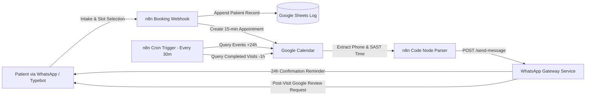

# WhatsApp Dental Clinic Booking & Lifecycle Automation

An end-to-end automated patient scheduling, calendar synchronization, and post-visit follow-up system built with **n8n**, **Typebot**, **WhatsApp**, and **Google Workspace**, deployed on a self-hosted Linux VPS.

## System Architecture



## Key Workflows

### 1. Real-Time Booking & Calendar Sync (`workflows/dental-booking-main.json`)
- **Webhook Ingestion:** Receives structured booking payloads (`name`, `phone`, `start_time`, `platform`, `tier`) from the conversational intake flow.
- **CRM & Audit Logging:** Appends timestamped patient booking records to Google Sheets via a Google Service Account.
- **Automated Calendar Provisioning:** Schedules confirmed appointments in Google Calendar with patient contact metadata and dynamic end-time calculation.

### 2. Automated Reminders & Review Pipeline (`workflows/appointment-reminders.json`)
- **Scheduled Polling:** Executes every 30 minutes via an n8n `Schedule Trigger` to scan upcoming and recently completed appointments.
- **24-Hour Pre-Appointment Reminders:** Queries events occurring within the 23.5h–24h window, formats timestamps to `Africa/Johannesburg` (`SAST / UTC+2`), and dispatches confirmation prompts over WhatsApp.
- **Post-Visit Google Review Requests:** Queries completed appointments 1 hour post-visit and triggers personalized WhatsApp review requests to boost clinic reputation.

## Repository Structure

```text
whatsapp-dental-booking-agent/
├── workflows/
│   ├── dental-booking-main.json      # Webhook -> Google Sheets -> Google Calendar sync
│   └── appointment-reminders.json    # 30-min cron -> 24h reminders & 1h review requests
├── scripts/                          # Helper utilities and validation scripts
├── docs/                             # Architecture notes and setup documentation
├── .gitignore                        # Excludes .env, credentials.json, and secret keys
└── LICENSE                           # MIT License
```

## Setup & Deployment

1. **Self-Hosted Stack:** Provision a Linux VPS (Ubuntu) with Docker and configure swap memory for stable container execution.
2. **Import Workflows:** In n8n, go to **Workflows -> Import from File** and import both `.json` files from `/workflows`.
3. **Configure Credentials & Placeholders:**
   - Connect your **Google Sheets Service Account** and **Google Calendar OAuth2** credentials in n8n.
   - Replace placeholder values (`YOUR_GOOGLE_SHEET_ID`, `YOUR_GOOGLE_CALENDAR_ID`, `YOUR_WHATSAPP_GATEWAY_HOST`, `YOUR_INTERNAL_WEBHOOK_SECRET`, and `YOUR_GOOGLE_REVIEW_URL`) with your environment values.
4. **Activate:** Enable both workflows and verify webhook delivery from your Typebot / WhatsApp gateway.

## Security Practices
- All API tokens, OAuth credential IDs, spreadsheet IDs, and internal service endpoints are stripped from version-controlled workflow exports.
- Local secrets (`.env`, `credentials.json`, `token.json`) are excluded via `.gitignore`.